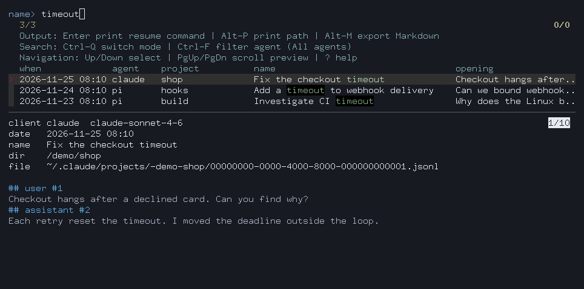

# asf - agent session finder

Find a past coding-agent session by its name, or by anything said inside it. Claude Code,
Codex, Pi, OpenCode, Gemini, Copilot, Hermes, and Antigravity.



Run `asf -i` to pick a session. Type to search by name, `Ctrl-Q` to search inside
sessions, and `Enter` to print the command that reopens the selected session.
Press `?` for picker keys or run `asf --help` for command-line options.

## For agents

The [ASF skill](skills/asf/SKILL.md) shows how to find and read past sessions.
To search transcript text with ripgrep and return sessions from this exact working directory:

```sh
asf --cwd . -c 'staging directory' --paths
```

<!-- PI/OpenAI: skill link and working-directory search example. -->

## Install

Download a [prebuilt Linux binary](https://github.com/wassname/asf/releases/latest),
or install from a checkout with current stable Rust:

```sh
cargo install --path . --locked
```

On Ubuntu, install `sqlite3` only if you read Hermes or Antigravity sessions:

```sh
sudo apt install sqlite3
```

<!-- PI/OpenAI: demo and install instructions. -->
